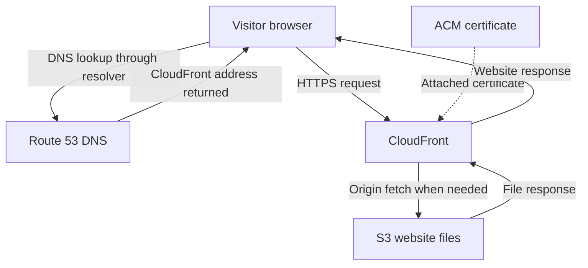

# AWS Portfolio Deployment with Custom Domain & HTTPS

A hands-on cloud deployment project using **Amazon S3, Amazon CloudFront, Amazon Route 53, and AWS Certificate Manager (ACM)** to publish a static Next.js portfolio through a custom domain.

**Portfolio:** [ritikdevops.site](https://ritikdevops.site/)  
**Author:** Ritik Kumar  
**Focus:** AWS hosting, DNS, HTTPS, caching, and deployment troubleshooting

## Overview

I built this project as part of my DevOps learning journey to understand how a website moves from a local build to a publicly accessible cloud deployment.

The project started with uploading static website files to S3 and enabling website access. I then connected CloudFront and worked through custom domain configuration, DNS records, and certificate validation.

The frontend is a static export of a Next.js portfolio. S3 stores the generated files; it does not run a Next.js application server.

> **Documentation scope:** This README describes the deployment journey and a reproduction guide. Exact resource IDs and the final CloudFront origin access configuration are not included. Private S3 access through OAC, CI/CD, monitoring, and infrastructure as code are future improvements, not completed features. The troubleshooting guide below is not a claim that every listed issue occurred.

## Technology Stack

| Technology | Role in this project |
| --- | --- |
| Next.js static export | Generates the portfolio's HTML, CSS, JavaScript, and assets |
| Amazon S3 | Stores the exported website files |
| Amazon CloudFront | Delivers website content and caches eligible responses |
| Amazon Route 53 | Hosts DNS records that resolve the custom domain to CloudFront |
| AWS Certificate Manager | Provides the certificate used for HTTPS at CloudFront |
| Domain registrar | Manages domain registration and delegation to DNS name servers |

## Architecture



Route 53 participates in DNS resolution; it does not carry the website's HTTP traffic. ACM manages the certificate attached to CloudFront; each visitor request does not pass through ACM.

### Request flow

1. A visitor opens `https://ritikdevops.site/`.
2. DNS resolves the hostname to CloudFront. DNS answers may already be cached.
3. The browser establishes an HTTPS connection with CloudFront.
4. CloudFront serves a usable cached response or fetches the requested object from S3.
5. The browser loads the HTML and requests the referenced CSS, JavaScript, and images.

## Why These Services?

### S3: store the website build

This portfolio can be exported as files, so it does not need an always-running application server. S3 stores those files as objects identified by keys such as `index.html` and `_next/static/...`.

### CloudFront: deliver and cache content

CloudFront sits in front of the origin and can reuse cached responses. It also provides the public HTTPS endpoint for the custom domain. This project does not claim a measured latency improvement or load-test result.

### Route 53: connect the domain

The registrar manages domain registration. Route 53 manages the DNS records after the registrar delegates the domain to the hosted zone's name servers. An alias record points the website hostname to CloudFront.

### ACM: enable HTTPS

The certificate covers the domain name used by visitors. DNS validation proves domain control, while attaching the issued certificate to CloudFront enables its use for viewer HTTPS connections.

## Deployment Guide

The following is a reproduction guide. Match the settings to the actual application and selected origin type rather than treating every example as an exported configuration.

### 1. Prepare the static Next.js build

Enable static export in the existing Next.js configuration. For a project using `next.config.mjs`, a minimal example is:

```javascript
const nextConfig = {
  output: 'export',
};

export default nextConfig;
```

Merge this setting with existing configuration rather than replacing it blindly. Projects using `next/image` need a static-compatible image setup, such as a custom image loader or disabling built-in optimization.

Build using the project's package manager. For an npm project with a committed lockfile:

```bash
npm ci
npm run build
```

The default export directory is `out/`. Upload its **contents**, including generated asset directories. Uploading the source code alone does not create a running website.

Features that require a Next.js server at request time need a different hosting arrangement. A static frontend can still call an independently hosted API.

### 2. Upload the build to S3

1. Create a dedicated bucket for public website assets.
2. Upload the exported files while preserving their directory paths.
3. Confirm that `index.html` is at the expected object key.
4. Check that HTML, CSS, JavaScript, and images have appropriate content types.

For the initial S3 website-hosting exercise, enable static website hosting and use `index.html` as the index document. Public website access depends on the bucket policy and applicable Block Public Access settings. Limit public access to intended website files; do not upload private data.

### 3. Connect CloudFront to the correct origin

S3 supports two different origin patterns:

| Configuration | S3 website endpoint | S3 REST bucket endpoint |
| --- | --- | --- |
| CloudFront origin type | Custom origin | S3 origin |
| Private access through OAC | Not supported | Supported |
| S3 website index behavior | Available | Not available automatically |
| CloudFront-to-origin HTTPS | Not supported by website endpoint | Supported |

The initial project used public S3 website hosting. Confirm the distribution's actual origin hostname before describing the final deployment as private or end-to-end HTTPS.

Configure CloudFront with the chosen origin, set `index.html` as the default root object, and select **Redirect HTTP to HTTPS** for viewer requests. Allow the distribution changes to deploy, then test its generated domain.

The default root object handles `/`; it does not automatically resolve every nested route to an `index.html` file when using the S3 REST origin.

### 4. Delegate DNS to Route 53

1. Create a public hosted zone for `ritikdevops.site`.
2. Copy the hosted zone's assigned name servers.
3. Set those name servers at the domain registrar.
4. Verify that public DNS uses the intended hosted zone.

Creating a hosted zone alone does not change the domain's authoritative DNS. If duplicate hosted zones exist, use the one whose name servers match the registrar delegation.

### 5. Request and validate the certificate

For a CloudFront viewer certificate, request the ACM certificate in **US East (N. Virginia), `us-east-1`**.

Request `ritikdevops.site`. Include `www.ritikdevops.site` only if that hostname will also be served. Choose DNS validation and create the CNAME record values supplied by ACM in the authoritative DNS zone.

Wait for **Issued**, then attach the certificate to CloudFront. Keep the validation records for renewal. A certificate for `*.ritikdevops.site` does not cover the apex `ritikdevops.site` unless the apex is also included.

### 6. Add the domain to CloudFront and create routing records

Add `ritikdevops.site` as a CloudFront alternate domain name and use a certificate that covers it. Then create the appropriate Route 53 records:

| Record | Purpose |
| --- | --- |
| Apex A alias → CloudFront | Routes IPv4 DNS resolution to the distribution |
| Apex AAAA alias → CloudFront, if IPv6 is enabled | Supports IPv6 DNS resolution |
| ACM-provided validation CNAME | Proves domain control for certificate validation |
| Optional `www` alias records | Routes the additional hostname to CloudFront |

For `www`, configure DNS, certificate coverage, and the CloudFront alternate domain name. A DNS record alone does not configure the other two. Serving both hostnames also does not automatically redirect one to the other.

## Updating the Website

1. Change the frontend locally and generate a fresh static export.
2. Upload the changed build files to the correct S3 keys.
3. Preserve assets still required by previously cached pages.
4. If unchanged URLs serve old content, check cache settings and invalidate the affected paths as needed.
5. Test the page, asset loading, and navigation again.

CloudFront cache and browser cache are separate. Invalidating CloudFront does not clear a visitor's browser cache. Versioned asset names help distinguish new content from older cached files.

### Optional AWS CLI workflow

These commands are reference examples for a future repeatable upload workflow, not a claim that CLI deployment is already implemented. Use an authorized AWS CLI session and replace both example values before running.

```bash
# Confirm the active AWS identity.
aws sts get-caller-identity

# Upload the build without deleting existing objects.
aws s3 sync ./out/ s3://YOUR_BUCKET_NAME/ --dryrun
aws s3 sync ./out/ s3://YOUR_BUCKET_NAME/

# Refresh changed entry content when necessary.
aws cloudfront create-invalidation \
  --distribution-id YOUR_DISTRIBUTION_ID \
  --paths "/" "/index.html"
```

Choose invalidation paths that match the actual changes, including nested pages if applicable. The upload example leaves old objects in place; deliberate cleanup can be added later.

## Troubleshooting Guide

During setup, I encountered questions around certificate validation and DNS configuration. The table below records a diagnostic approach; it does not assign an unverified root cause to a past failure.

| Symptom | What to inspect | Possible corrective action |
| --- | --- | --- |
| Domain does not resolve | Registrar delegation, hosted zone, alias record | Correct the authoritative zone or missing record |
| ACM remains pending | Validation CNAME name/value and public DNS visibility | Publish the exact ACM record in authoritative DNS |
| ACM shows failed | ACM failure reason and domain validation state | Address the reported cause; request a new certificate if needed |
| Certificate is not selectable | AWS account, `us-east-1` region, issuance status | Use an issued certificate in the required account and region |
| HTTPS hostname error | Certificate coverage and CloudFront alternate names | Align the requested hostname, alias, and certificate |
| S3 or CloudFront returns 403 | Object key, origin type, permissions, root object | Fix the missing object or access configuration |
| Root page works, nested page fails | Exported file path and origin routing behavior | Align requests with generated files; add deliberate rewrites if required |
| Old content is visible | S3 object, browser cache, CloudFront response | Upload the correct build and refresh affected caches |
| CSS or images fail | Browser Network tab, asset paths, uploaded files | Restore missing assets or correct paths and content types |

**Certificate lesson:** An older certificate having existed for the same domain does not by itself prove why a new request failed. Use the actual ACM failure reason. Attaching a certificate to CloudFront is also separate from completing ACM DNS validation.

## Verification Checklist

Use this checklist when validating a deployment or update; unchecked items are not completed test results.

- [ ] The custom domain resolves publicly.
- [ ] HTTPS loads without a certificate warning.
- [ ] HTTP redirects to HTTPS.
- [ ] CSS, JavaScript, and images load successfully.
- [ ] Direct navigation and refresh work on any nested pages.
- [ ] The deployed page matches the intended build.
- [ ] The optional `www` hostname works if configured.
- [ ] The documented origin type matches CloudFront.

Useful read-only checks from a terminal with these tools installed:

```bash
nslookup -type=NS ritikdevops.site
nslookup ritikdevops.site
curl -I https://ritikdevops.site/
curl -I http://ritikdevops.site/
```

Inspect the HTTP status and response headers. Browser developer tools help check individual assets and console errors. In PowerShell, use `curl.exe` if `curl` resolves to a PowerShell alias.

## Evidence to Add

Keep screenshots under a `screenshots/` directory. Suggested captures:

| Suggested filename | What it should demonstrate |
| --- | --- |
| `01-s3-objects.png` | Exported files and object paths |
| `02-cloudfront-origin.png` | Actual origin type and hostname |
| `03-route53-records.png` | Website routing and validation record types |
| `04-acm-issued.png` | Issued certificate and covered domain |
| `05-live-portfolio.png` | Portfolio displayed through HTTPS |

Screenshots are not bundled with this README. Add real evidence before linking images. Remove credentials, tokens, and unrelated account details from captures.

## What I Learned

- How a static frontend differs from an application requiring a server runtime.
- How S3 storage, CloudFront delivery, DNS resolution, and TLS fit together.
- Why domain registration and DNS hosting are different responsibilities.
- Why an ACM validation record differs from the website's DNS routing record.
- How to investigate a deployment issue one layer at a time.

## Limitations and Future Improvements

- **Private origin:** Confirm the current origin and migrate to a private S3 REST origin with OAC if needed.
- **CI/CD:** Automate build and upload through GitHub Actions with short-lived AWS credentials.
- **Infrastructure as code:** Reproduce resources with Terraform after learning the required concepts.
- **Observability:** Add useful access logs, availability checks, and operational alerts.
- **Cache strategy:** Document HTML and asset cache policies and repeatable invalidation steps.
- **Cost tracking:** Review usage and configure budget notifications; this README makes no zero-cost claim.

This is a learning deployment. High availability testing, performance benchmarks, and production security validation are not claimed.

## Official References

- [Next.js static exports](https://nextjs.org/docs/app/guides/static-exports)
- [S3 website endpoints](https://docs.aws.amazon.com/AmazonS3/latest/userguide/WebsiteEndpoints.html)
- [Restrict access to an S3 origin with CloudFront](https://docs.aws.amazon.com/AmazonCloudFront/latest/DeveloperGuide/private-content-restricting-access-to-s3.html)
- [Configure DNS for a new domain](https://docs.aws.amazon.com/Route53/latest/DeveloperGuide/dns-configuring-new-domain.html)
- [Route a custom domain to CloudFront](https://docs.aws.amazon.com/Route53/latest/DeveloperGuide/routing-to-cloudfront-distribution.html)
- [Configure alternate domain names and HTTPS](https://docs.aws.amazon.com/AmazonCloudFront/latest/DeveloperGuide/cnames-and-https-procedures.html)
- [CloudFront alternate domain name requirements](https://docs.aws.amazon.com/AmazonCloudFront/latest/DeveloperGuide/CNAMEs.html)
- [CloudFront invalidations](https://docs.aws.amazon.com/AmazonCloudFront/latest/DeveloperGuide/Invalidation.html)
- [Versioned file names for updates](https://docs.aws.amazon.com/AmazonCloudFront/latest/DeveloperGuide/UpdatingExistingObjects.html)
